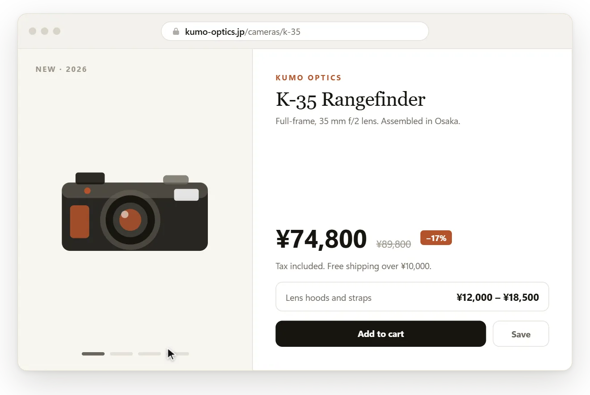
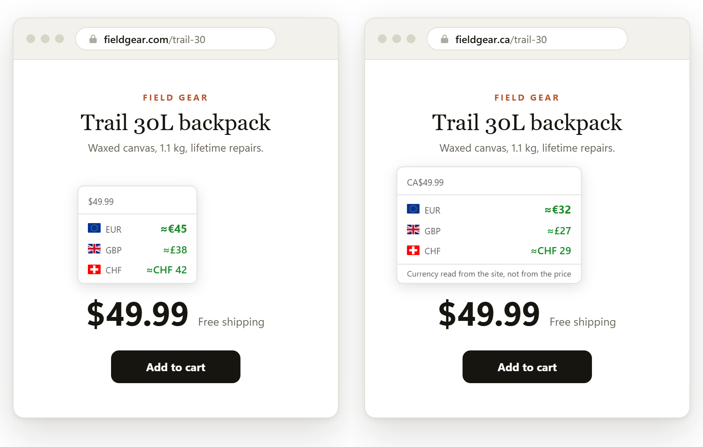
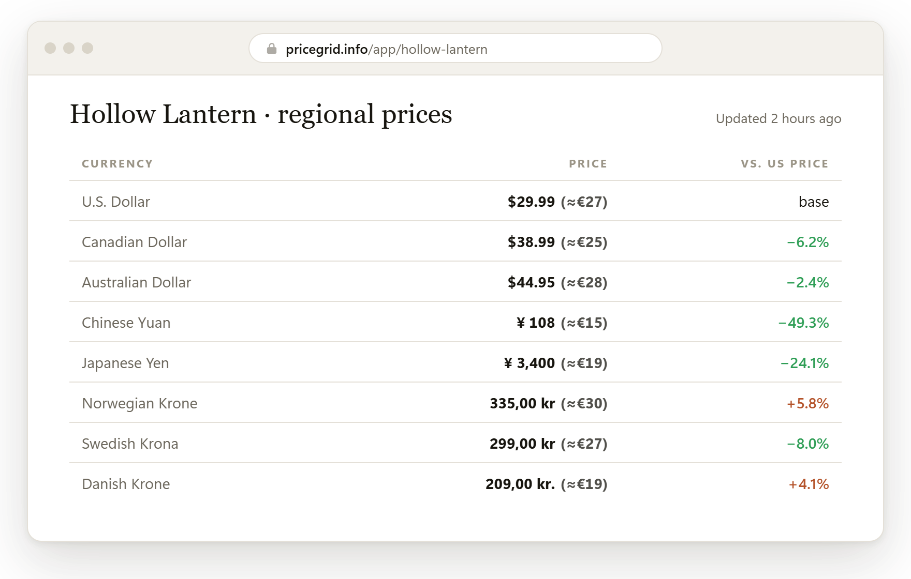
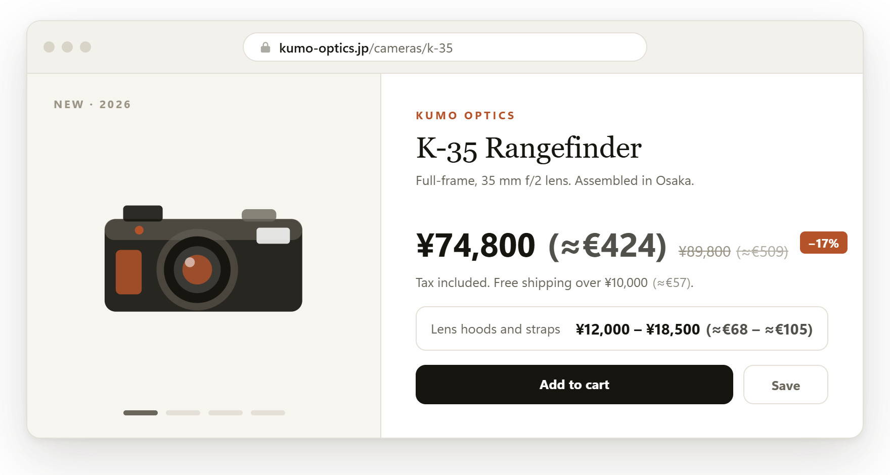
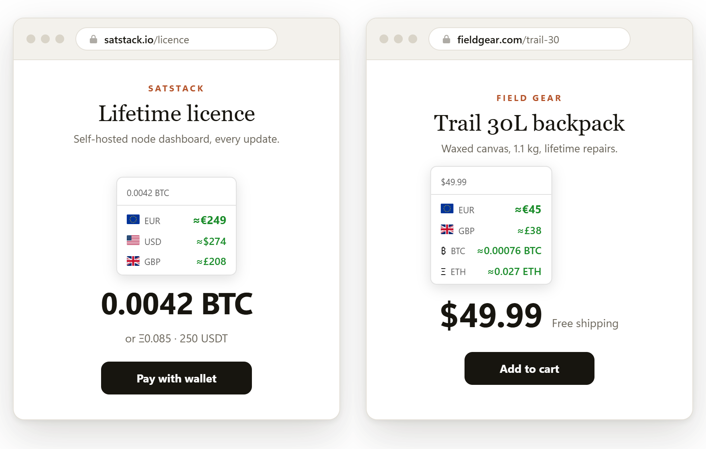
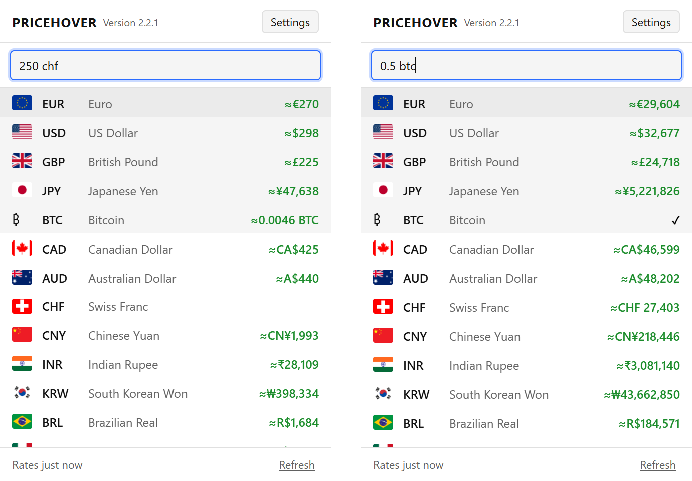
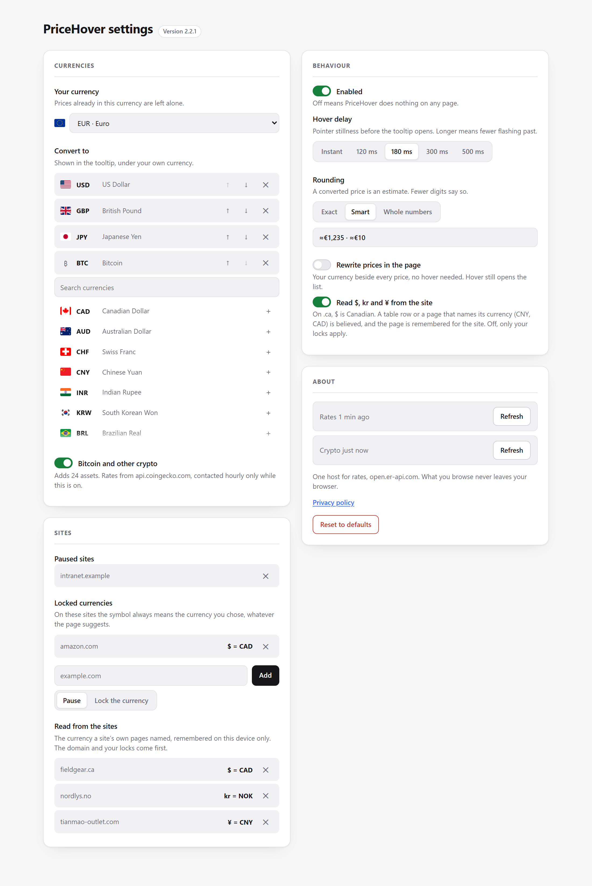

<h1 align="center">PriceHover</h1>
<p align="center">Hover any price on any page and read it in your own currency.<br />Chrome and Firefox, MV3, built with WXT and Svelte 5.</p>

<p align="center">
  <a href="https://github.com/klNuno/PriceHover/releases"></a>
  <a href="./LICENSE"></a>
  <a href="https://github.com/klNuno/PriceHover/stargazers"></a>
  <a href="#install"></a>
  <a href="https://wxt.dev/"></a>
  <a href="https://svelte.dev/"></a>
  <a href="https://chromewebstore.google.com/detail/pricehover/mlmaihdejjfkpppbmpnefhfgfhcgpjek"></a>
  <a href="https://addons.mozilla.org/firefox/addon/pricehover"></a>
</p>

<p align="center">
  <picture>
    <source media="(prefers-color-scheme: dark)" srcset="./screenshots/demo-dark.webp" />
    
  </picture>
</p>

<p align="center">
  <a href="#install">Install</a> ·
  <a href="#what-it-reads">What it reads</a> ·
  <a href="#inline-mode">Inline mode</a> ·
  <a href="#crypto-both-ways">Crypto</a> ·
  <a href="#the-popup-is-also-a-converter">Popup</a> ·
  <a href="#privacy">Privacy</a>
</p>

## Why

A price in a currency you do not think in costs a tab, a search box and your
place in the page. PriceHover reads it where it sits. No account, no paste, one
request a day for the rates.

## Features

- **Hover or select** a price. Your own currency comes first and is never converted away from. On a fresh install it is guessed from your browser's language (`en-US` is dollars, `fr-FR` euros), ready to change on the settings page that opens.
- **`$` means what the site means.** `$49` on a `.ca` shop is Canadian, `1 099 kr` on a `.no` shop is Norwegian, `¥` on a `.cn` shop is yuan. A table row that names its currency decides for the prices in it, and a site that names its currency once is remembered for the whole site.
- **Lock a site's currency** when you know better: `amazon.com` with `$ = CAD`, from the settings page.
- **Prose stays prose.** `try 100 times` and `error code 500 KD` are not prices. Every ambiguous token has a rejection test behind it.
- **Japanese shops.** `1,980円`, `500 yen` and `28,133Yen` are yen; `円500` and a `円` inside a word are not.
- **Ranges.** `€10 – €20`, `€10-20` and `10-20 kr` convert as one range.
- **Click a row to copy** the amount. The card's header repeats the page's price with every digit it printed.
- **Inline mode.** Write your currency beside every price instead of waiting for a hover, or in its place. The page's own text is never edited.
- **Two switches.** A master one and a per-site pause, both in the popup.
- **A calculator in the popup.** `20 chf`, `100 eur jpy`, and `0.5 btc` once crypto is on.
- **Rounding.** `≈€1,235` where `€1,234.56` would pretend to a precision a conversion does not have.
- **Sub-cent prices stay prices.** A yen is `€0.0061`, not `€0.01`, and never `€0`. Per-unit and prorated prices (`$0.0075`) are read too.
- **Crypto, if you want it.** 24 assets including BTC, ETH, XMR, USDT, USDC and DOGE. Off by default, one extra host, granted by you and given back when you switch it off.
- **44 currencies, eight languages.** Flags are bundled, nothing is fetched from a third party.

## What it reads

### The same `$49.99`, two shops

<p align="center">
  <picture>
    <source media="(prefers-color-scheme: dark)" srcset="./screenshots/context-dark.png" />
    
  </picture>
</p>

The country comes from the domain, or from the region in `<html lang>` when the
domain says nothing. Vanity endings (`.co`, `.io`, `.ai`, `.me`, `.tv`, `.to`)
are ignored, because the country in them means nothing. When the site decided
and not the price, the card says so. Settings → **Behaviour** → *Read `$`, `kr`
and `¥` from the site* turns all of this off, except on sites you locked.

### One table, eight currencies, three symbols

<p align="center">
  <picture>
    <source media="(prefers-color-scheme: dark)" srcset="./screenshots/table-dark.png" />
    
  </picture>
</p>

Two things outrank the domain: a code printed beside the price (`$49 CAD`), and
the row the price sits in, so SteamDB's `¥ 69` on the Chinese Yuan row is yuan
while the `¥ 1,980` on the Japanese Yen row stays yen. One thing ranks below it:
what the site's own pages said, remembered per site on your machine and listed
in the settings, where each entry can be removed. A lock you set yourself beats
all of them.

| On the page | Read as |
| --- | --- |
| `¥74,800` on a `.jp` shop | 74 800 JPY |
| `¥74,800` on a `.cn` shop | 74 800 CNY |
| `$49.99 CAD` anywhere | 49.99 CAD |
| `¥ 69` on a row labelled Chinese Yuan | 69 CNY |
| `₹1,49,900` | 149 900 INR (Indian lakh grouping) |
| `KD 12.500` | 12.500 KWD (three decimals, not thousands) |
| `€10-20` | a range, 10 to 20 EUR |
| `try 100 times`, `requires PHP 8.2`, `error code 500 KD` | nothing |

## Inline mode

<p align="center">
  <picture>
    <source media="(prefers-color-scheme: dark)" srcset="./screenshots/inline-dark.png" />
    
  </picture>
</p>

Off by default. Two styles: both prices, or *Mine only*, which shows your
currency where the page's price was. Neither edits the site's text: *Mine only*
hides the price cell with a style and gives it back untouched when you switch
it off, and a price in the middle of a sentence still gets a badge beside it.
A badge that would push its line onto a second one is taken back. Text fields,
editable areas, `code` and `pre` are left alone.

## Crypto, both ways

<p align="center">
  <picture>
    <source media="(prefers-color-scheme: dark)" srcset="./screenshots/crypto-dark.png" />
    
  </picture>
</p>

Off by default. One switch in the settings turns it on, your browser asks for
`api.coingecko.com`, and from then on:

- **Crypto prices on a page convert like any other.** `0.0042 BTC`, `₿0.05`,
  `Ξ0.085`, `250 USDT`, and the tickers XMR, USDC, DOGE, XRP, LTC and BCH.
  `ETH 8092` stays a Zurich postal code and `BTC 10000` a headline.
- **Any of the 24 assets can sit in your list**, so a price in dollars also
  reads in bitcoin or ether.
- **The popup takes them too**: `0.5 btc`, `100 eur eth`.
- **Rates have their own clock**, refreshed hourly while the switch is on, with
  a warning on the card when they are stale.

Switching it off hands the permission back, and nothing contacts the second
host again.

## The popup is also a converter

<p align="center">
  <picture>
    <source media="(prefers-color-scheme: dark)" srcset="./screenshots/popup-dark.png" />
    
  </picture>
</p>

Type `250 chf`, `20 usd jpy`, `0.5 btc` once crypto is on, or a bare number to
convert from your own currency. The footer says how old the rates are and refreshes them on demand.

## Settings

<p align="center">
  <picture>
    <source media="(prefers-color-scheme: dark)" srcset="./screenshots/options-dark.png" />
    
  </picture>
</p>

Your own currency, the list to convert into and its order, hover delay,
rounding, inline mode, paused sites, locked site currencies, and the currencies
read from each site.

## Privacy

PriceHover contacts exactly one host, `open.er-api.com`, and asks it one
question: today's exchange rates. That request carries nothing about you or the
page you are on. Prices are detected on your machine, flags are bundled in the
extension, and there is no analytics, no telemetry and no identifier. Two
permissions, `storage` and `open.er-api.com`, plus the page access every
content script needs to read the page it runs on.

Turning on crypto conversion adds a second host, `api.coingecko.com`, and
nothing else. It is off by default, your browser asks before granting it, and
switching it back off hands the permission back.

Full details in the [privacy policy](PRIVACY.md).

## Install

- **Chrome**, and the Chromium browsers that install from its store (Brave,
  Edge, Vivaldi): [Chrome Web Store](https://chromewebstore.google.com/detail/pricehover/mlmaihdejjfkpppbmpnefhfgfhcgpjek).
- **Firefox** 127 or later: [addons.mozilla.org](https://addons.mozilla.org/firefox/addon/pricehover).
- **From a release zip**: every [release](https://github.com/klNuno/PriceHover/releases)
  carries `pricehover-<version>-chrome.zip`. Unzip it, open `chrome://extensions`,
  turn on developer mode and pick *Load unpacked*.

Both stores are uploaded by hand after a release and review each version, so a
store can trail the latest tag by a few days.

If PriceHover shows nothing on any page, your browser is withholding page
access, usually because site access was once set to "on click". The settings
page says so and gives it back in one click.

## Build from source

Needs [Bun](https://bun.sh). `bun install` also runs `wxt prepare`.

```bash
bun install
bun run dev                    # Chrome with the extension loaded, hot reload
bun run dev --browser firefox  # the same in Firefox
bun run build                  # Chrome MV3  -> .output/chrome-mv3
bun run build:firefox          # Firefox MV3 -> .output/firefox-mv3
bun run zip                    # .output/pricehover-<version>-chrome.zip
bun run zip:firefox            # the Firefox zip and the sources zip AMO asks for
bun test                       # unit tests, plus DOM tests under happy-dom
bun run typecheck              # tsc --noEmit, kept clean and enforced in CI
bun run crypto:check           # every CoinGecko id still answers
```

To load a build by hand: in Chrome, *Load unpacked* on `.output/chrome-mv3`; in
Firefox, `about:debugging#/runtime/this-firefox` → *Load Temporary Add-on* →
`.output/firefox-mv3/manifest.json`.

`bun run icons`, `bun run flags` and `bun run locales` regenerate committed
files and never run at build time. A release is cut by pushing a `vX.Y.Z` tag:
CI refuses a tag that disagrees with `package.json`, checks the locales, runs
the typecheck and the tests, builds both targets and attaches the zips.

## Contributing

Issues and pull requests are welcome. Keep `bun test` and `bun run typecheck`
clean, and never add a runtime request to a second host. Detection is the part
that breaks quietly: a token accepted one position too freely turns `error code
500 KD` into a price, so every new one arrives with the case that must stay
silent.

## License

[GNU General Public License v3.0 or later](LICENSE). Use it, read it, fork it.
Distributing a modified version, publishing a fork to a browser store included,
means releasing its source under the same license. Every dependency is
GPL-compatible, and only Svelte (MIT) ships inside the extension.
